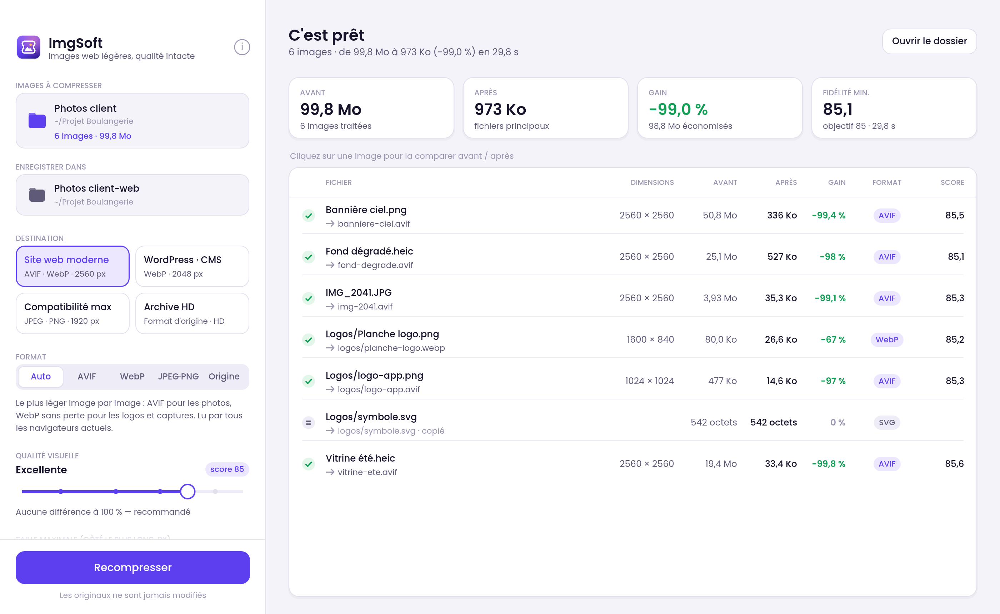
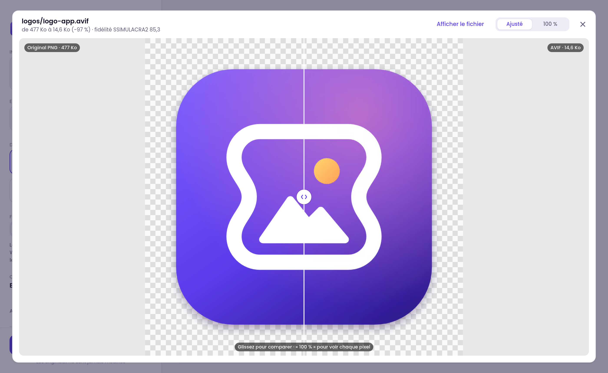
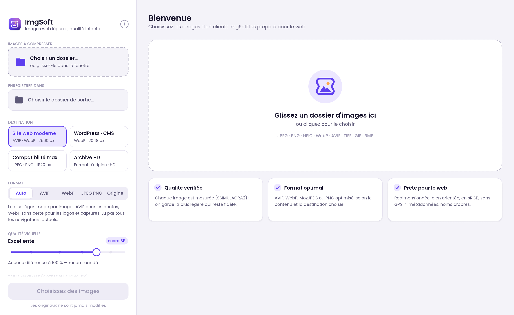
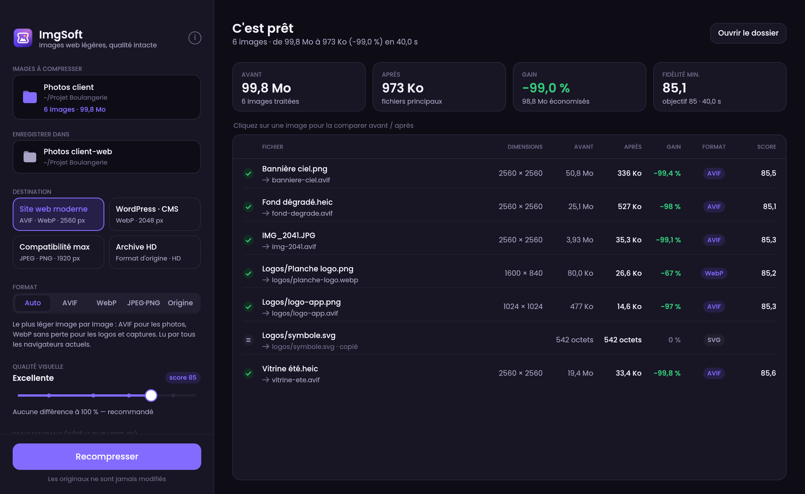

# ImgSoft — compresseur d'images pour le web (macOS, Rust) — v1.0.0

ImgSoft prépare les images d'un client pour un site web : vous glissez un dossier, vous choisissez où enregistrer le résultat, et chaque image ressort **aussi légère que possible sans différence visible**, dans le format le plus adapté à sa destination.

| Résultats | Comparaison avant / après |
|---|---|
|  |  |

| Accueil | Mode sombre |
|---|---|
|  |  |

## Comment ça marche

La plupart des outils appliquent une « qualité 80 » à toutes les images. Or le même réglage abîme une photo de ciel (dégradés) et gaspille des octets sur une photo de feuillage. ImgSoft procède autrement, image par image :

1. **Décodage fidèle** : JPEG, PNG, HEIC (iPhone), WebP, AVIF, TIFF, GIF, BMP, JPEG XL… L'orientation EXIF est appliquée et les profils de couleur (Display P3, Adobe RGB, CMJN) sont convertis en sRGB, l'espace des navigateurs.
2. **Redimensionnement** au côté maximal choisi (2560 px par défaut, jamais d'agrandissement), en Lanczos3 **en lumière linéaire** avec alpha prémultiplié : pas de détails assombris, pas de franges autour des transparences.
3. **Recherche de la qualité juste** : l'image est encodée, décodée, puis mesurée avec **SSIMULACRA2** (la métrique perceptuelle de référence de JPEG XL). ImgSoft cherche le réglage le plus bas qui atteint le score visé (interpolation sécante, 2 à 4 essais en moyenne).
4. **Choix du format** : plusieurs encodeurs sont mis en concurrence ; le plus petit fichier qui atteint l'objectif l'emporte. Un encodeur qui ne peut plus gagner est abandonné en cours de route.
5. **Nettoyage** : métadonnées retirées (GPS, appareil, miniatures, images de profondeur des iPhone), noms de fichiers web, sous-dossiers reproduits.

Si le fichier d'origine est déjà plus léger que tout ce qu'on peut produire (image web déjà optimisée), il est conservé, simplement débarrassé de ses métadonnées.

### Qualité visée (score SSIMULACRA2)

| Préréglage | Score | En pratique |
|---|---|---|
| Sans perte visible | 90 | Indiscernable de l'original, même zoomé |
| **Excellente** (défaut) | **85** | Aucune différence à 100 % |
| Très bonne | 80 | Différences invisibles en usage normal |
| Bonne | 72 | Vignettes, fonds, images secondaires |
| Légère | 62 | Le plus léger, petits défauts possibles |

### Destinations et formats

| Destination | Format | Taille max |
|---|---|---|
| **Site web moderne** | Auto : AVIF pour les photos, WebP sans perte pour logos et captures, le plus léger gagne | 2560 px |
| **WordPress · CMS** | WebP (avec ou sans perte) | 2048 px |
| **Compatibilité max** | MozJPEG pour les photos, PNG optimisé (palette ou sans perte) pour la transparence | 1920 px |
| **Archive HD** | Format d'origine optimisé (HEIC, TIFF, BMP → JPEG/PNG) | taille d'origine |

Tous les réglages restent modifiables un par un (format, qualité, taille, effort).

### Les encodeurs

| Format | Moteur | Réglages |
|---|---|---|
| AVIF | rav1e via ravif | 10 bits, 4:4:4, vitesse 6 (4 en effort max) |
| WebP | libwebp | sharp YUV, méthode 6, alpha sans perte ; WebP sans perte pour les aplats |
| JPEG | MozJPEG | trellis, progressif, scans optimisés, 4:2:0 ou 4:4:4 selon l'objectif, niveaux de gris détectés |
| PNG | libimagequant + oxipng | palette 256/128/64 couleurs si elle atteint l'objectif, sinon sans perte ; réduction de profondeur automatique |

## Fonctions

* Glisser-déposer d'un dossier (parcours récursif) ou de fichiers.
* Dossier de sortie proposé automatiquement (`<dossier>-web`), sous-dossiers reproduits ; **les originaux ne sont jamais modifiés**.
* **Variantes responsive** pour `srcset` (`photo-640w.avif`, `photo-1024w.avif`…).
* **Manifeste JSON** optionnel (`imgsoft-manifest.json`) : largeur, hauteur, poids et variantes de chaque image, pour écrire `` sans décalage de mise en page.
* Copie des SVG, ICO et animations (GIF/WebP/APNG animés) telles quelles, pour un dossier complet.
* Tableau en direct : dimensions, poids avant/après, gain, format, score mesuré.
* **Comparateur avant/après** : curseur glissant, vue ajustée ou 100 % (pixel pour pixel), damier pour la transparence.
* Mode clair et sombre (suit macOS), réglages mémorisés, annulation à tout moment.
* Outil en ligne de commande `imgsoft` (inclus dans l'app).

## Installation

Téléchargez `ImgSoft-1.0.0.dmg`, ouvrez-le et glissez ImgSoft sur Applications. L'app n'est pas signée par un développeur Apple identifié : au premier lancement, *Réglages Système > Confidentialité et sécurité > Ouvrir quand même*.

**macOS 11 Big Sur ou plus récent**, Apple Silicon et Intel (binaire universel). La vérification des fichiers AVIF utilise le décodeur de macOS 13+ ; sur macOS 11–12, ImgSoft applique un réglage AVIF calibré sans mesure.

## Ligne de commande

```sh
/Applications/ImgSoft.app/Contents/MacOS/imgsoft "Photos client" -o "Photos client-web"
imgsoft photos -o web -f webp -q 80 -m 1920 -w 640,1024 --manifest
```

| Option | Effet |
|---|---|
| `-o, --output <dossier>` | dossier de sortie (obligatoire) |
| `-f, --format` | `auto` (défaut), `avif`, `webp`, `classic` (JPEG/PNG), `keep` |
| `-q, --quality <score>` | score SSIMULACRA2 visé, 50–95 (défaut 85) |
| `-m, --max <px>` | côté le plus long (défaut 2560, `0` = taille d'origine) |
| `-w, --widths <liste>` | variantes responsive, ex. `640,1024,1600` |
| `-e, --effort` | `fast`, `balanced` (défaut), `max` |
| `--no-slug`, `--manifest`, `--no-copy`, `-j <n>` | noms d'origine, manifeste JSON, pas de copie SVG/ICO/animations, images en parallèle |

`IMGSOFT_DEBUG=1` affiche chaque essai de la recherche (qualité, taille, score, temps).

## Compiler

Prérequis : Rust 1.88+ (édition 2024), Xcode Command Line Tools, et pour le binaire universel `rustup target add x86_64-apple-darwin aarch64-apple-darwin` et `brew install nasm`.

```sh
cargo run --release -p imgsoft          # l'application
cargo run --release -p imgsoft-cli -- --help
cargo test -p imgsoft-core              # tests du moteur
scripts/bundle.sh [--universal]         # dist/ImgSoft.app
scripts/make_dmg.sh                     # dist/ImgSoft-<version>.dmg (universel)
```

### Organisation

```
crates/
  imgsoft-core/   moteur : décodage (image, ImageIO), couleurs (moxcms), redimensionnement,
                  encodeurs, SSIMULACRA2, recherche de qualité, lots, manifeste
  imgsoft/        application egui (barre de réglages, tableau, comparateur, fond du DMG)
  imgsoft-cli/    outil en ligne de commande `imgsoft`
packaging/        Info.plist, icône 1024 px, Lisez-moi du DMG
assets/logo/      symbole et icône en SVG, pistes de logo explorées
scripts/          bundle.sh, make_dmg.sh, dmg_layout.py
```

### Vérifications visuelles

L'app se pilote par variables d'environnement pour produire des captures sans clic :
`IMGSOFT_SOURCE=<dossier> IMGSOFT_OUTPUT=<dossier> IMGSOFT_AUTORUN=1 IMGSOFT_COMPARE=<n> IMGSOFT_THEME=dark IMGSOFT_WINDOW=1400x860 IMGSOFT_SCREENSHOT=capture.png`.
Ces lancements utilisent des réglages temporaires et ne touchent pas à vos préférences.

## Logo

Un cadre photo **pincé à la taille** : l'image qu'on comprime, sans flèche ni étau. Sources dans `assets/logo/` (symbole noir `symbol.svg`, icône macOS `app-icon.svg`, et les trois pistes étudiées dans `concepts/`).

## Licence

GPL-3.0-or-later (libimagequant est sous GPL-3.0). Police Poppins : SIL Open Font License 1.1.
